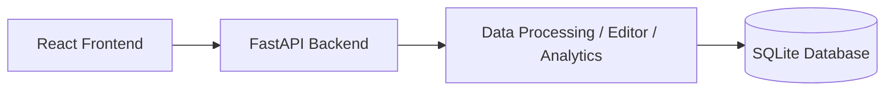
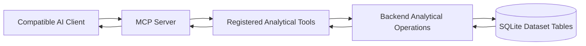

# GradientHarbor – AI-Powered Business Intelligence Platform & DataPilot MCP

[](https://www.python.org/)
[](https://fastapi.tiangolo.com/)
[](https://react.dev/)
[](https://www.typescriptlang.org/)
[](https://modelcontextprotocol.io/)
[](https://sqlite.org/)

GradientHarbor is a full-stack AI-powered business intelligence and data analysis platform. It lets users ingest CSV datasets, inspect schemas and distributions, assess data quality, transform data, detect statistical anomalies, compare periods, create calculated columns, explore data with restricted SQL, and export processed versions.

Its **DataPilot MCP server** exposes analytical capabilities through the [Model Context Protocol](https://modelcontextprotocol.io/) to compatible MCP AI clients. The server currently registers **11 analytical tools** (the implementation supersedes an earlier README count of nine). MCP provides a structured discovery and invocation layer: a compatible client selects a tool, sends validated arguments, and receives evidence from the actual dataset. An optional OpenAI-compatible endpoint can interpret that evidence, while a deterministic rule-based summary is used when no provider is configured.

The combination of a React dashboard, FastAPI analytical backend, SQLite workspace, controlled transformations, and MCP tool integration makes dataset exploration accessible through either the graphical interface or an AI client. GradientHarbor does not currently implement an autonomous multi-agent system; AI behavior is explicitly limited to tool selection and evidence-grounded interpretation.

## DataPilot MCP – AI-Powered Analytical Tool Integration

Model Context Protocol (MCP) is a standardized protocol for exposing tools and resources to AI clients. In GradientHarbor, MCP gives compatible AI clients a structured way to discover approved analytical operations instead of asking the model to fabricate dataset calculations. The backend implements the server with the official MCP Python SDK `FastMCP`; it communicates over stdio and connects to the same SQLite-backed analytical functions used by the REST API.

### Evidence-Grounded Analysis Workflow

1. **User request:** A user asks an analytical question about an uploaded or edited dataset.
2. **MCP client interaction:** The AI client or GradientHarbor backend discovers and selects an appropriate registered tool.
3. **Tool discovery:** The MCP server advertises tool names and JSON input schemas.
4. **Tool execution:** The selected tool is invoked with a dataset ID and operation-specific arguments.
5. **Data processing:** Python and SQLite process the selected dataset using profile, metrics, SQL, search, quality, anomaly, or visualization logic.
6. **Evidence generation:** The tool returns structured JSON derived from the dataset.
7. **AI interpretation:** An optional OpenAI-compatible chat-completions client may explain the returned evidence.
8. **Final insight:** The user receives an answer with descriptive evidence and limitations rather than unsupported assumptions.

The MCP stdio session is started by `POST /api/ai/chat` and `POST /api/analytics/ask` for relevant operations. When no API key is configured, chat uses deterministic summaries of the MCP evidence.

### Registered MCP Tools

The following table reflects `backend/mcp_server.py`.

| Tool | Purpose | Input parameters | Expected output |
|---|---|---|---|
| `list_datasets` | List available workspace datasets. | None | Array of dataset metadata: IDs, names, row/column counts, and upload time. |
| `inspect_dataset` | Inspect an approved dataset schema and sample. | `dataset_id: str` | Dataset metadata, inferred column types, row/column counts, schema, and up to five sample rows. |
| `profile_data` | Profile missingness and numeric/discrete distributions. | `dataset_id: str` | Per-column missing, distinct, and numeric summary statistics. |
| `run_readonly_sql` | Execute a restricted SQL query against one dataset table. | `dataset_id: str`, `query: str` | Columns, rows, row count, duration, and truncated status. |
| `detect_anomalies` | Screen numeric measures for extreme population z-scores. | `dataset_id: str` | Dataset ID, rows scanned, method description, and up to 100 anomaly findings. |
| `compare_periods` | Compare supported business metrics with the preceding equal-length period. | `dataset_id: str`, `days: int = 30` | Current/previous periods, current metrics, changes, and date-column caveats. |
| `get_business_metrics` | Calculate supported sales metrics. | `dataset_id: str`, `days: int = 30` | Revenue, active customers, order count, average order value, trend series, and support flags. |
| `search_dataset` | Case-insensitively search approved dataset values. | `dataset_id: str`, `term: str` | Up to 100 matching rows plus match count and truncation state. |
| `get_data_quality_report` | Return documented missing, duplicate, type, date, and outlier checks. | `dataset_id: str` | Quality score, issue list, severities, descriptions, and remediation guidance. |
| `recommend_visualizations` | Recommend charts supported by the selected schema. | `dataset_id: str` | Schema-aware visualization recommendations and dataset capabilities. |
| `aggregate_dataset` | Validate, filter, and aggregate a chart configuration. | `dataset_id: str`, `config: dict` | Chart-ready columns and rows, row count, configuration, and aggregation metadata. |

The MCP server also exposes the `datapilot://datasets` resource catalog and the `business_summary` prompt. These are discovery/readability helpers and are separate from the 11 callable tools.

### MCP Architecture

```mermaid
flowchart LR
    U[User] --> HC[AI Client / MCP Host]
    HC --> MC[MCP Client]
    MC -->|MCP stdio protocol| MS[DataPilot MCP Server]
    MS --> T[11 Registered Analytical Tools]
    T --> BE[GradientHarbor FastAPI Backend]
    BE --> AL[Python / SQLite Analytical Operations]
    AL --> SR[Structured Analytical Results]
    SR --> AI[AI Client Interpretation]
    AI --> FI[Final Evidence-Grounded Insights]

    subgraph MCP Communication
        HC
        MC
        MS
    end

    subgraph Analytical Execution
        T
        BE
        AL
        SR
    end
```



MCP is the communication and tool-discovery layer. Dataset processing remains in GradientHarbor's backend and is not performed autonomously inside the protocol server.

## AI-Powered Data Analysis Capabilities

- **Dataset inspection and profiling:** infer schema and types, count rows and columns, show samples, and summarize missingness and distributions.
- **Data quality assessment:** calculate a reproducible 0–100 score and identify missing values, duplicates, type inconsistencies, invalid dates, and statistical outliers.
- **Missing-value transformation:** fill missing values with literals, means, medians, or modes; clean missing markers; remove missing rows or columns.
- **Anomaly detection:** use population z-scores with an absolute threshold of 3, excluding identifier and binary 0/1 columns.
- **SQL-based exploration:** run read-only SQLite queries against only the selected dataset table.
- **Date-filtered analytics:** recognize date columns and calculate 7-, 30-, 90-day or custom date-range metrics.
- **Calculated columns:** add numeric columns from a restricted arithmetic expression grammar.
- **Bulk transformations:** replace values, conditionally update records, normalize text, round values, convert types, remove duplicates, split/combine/rename columns, and flag out-of-range numbers.
- **Evidence-grounded results:** MCP tools return structured JSON based on the stored dataset, and chat responses label rule-based or optional LLM interpretation.
- **CSV export:** download the original working copy or export staged editor operations.

## Intelligent Data Preparation & Transformation

### 1. Data Profiling

Dataset inspection reports dimensions, normalized column names, inferred SQLite types, and representative rows. Profiling summarizes missing counts, distinct counts, numeric minimum/maximum/mean and, for text-like columns, distinct values and most-common values.

### 2. Data Quality Assessment

The quality score is calculated as:

`100 × (1 − missing_cells / total_cells) − duplicate_rows / row_count × 100`

The result is bounded to 0–100 and is unavailable for an empty dataset. The report includes missing-value and duplicate checks, non-numeric values in mostly numeric columns, invalid recognized date values, and z-score outliers. Objective validation findings and outlier warnings are separate from the score.

### 3. Missing-Value Imputation

The editor supports literal fills and numeric/text-compatible mean, median, and mode strategies. Mean and median fills are restricted to numeric columns. Bulk previews report type validation errors and warnings before changes are staged.

### 4. Calculated Columns

Calculated columns use Python AST-based arithmetic parsing with numeric column references. The implementation does not evaluate arbitrary Python code.

### 5. Bulk Transformations

Supported transformations include exact/contains replacement, conditional updates, text trim/normalization/case conversion, rounding, type conversion (`TEXT`, `INTEGER`, `REAL`, `BOOLEAN`, `DATE`), missing-marker cleanup, missing-row removal, duplicate removal, column rename/split/combine, missing-column removal, and numeric range review flags.

### 6. Anomaly Detection

Anomalies are detected from non-identifier numeric columns using population z-scores at `|z| >= 3`. Columns with fewer than four values, identifier-like names, and binary 0/1 columns are excluded. Returned findings are capped at 100 and are statistical warnings, not causal diagnoses.

### 7. Date-Based Analytics

Recognized date columns support inclusive date ranges and period comparisons. When a date column is not detected, the metrics implementation can explicitly fall back to all available rows and marks that limitation in the result.

### 8. CSV Export

The editor can export the current working copy or preview/export staged operations as UTF-8 CSV. **Save As New Dataset** creates an independent transformed dataset.

## SQL Workspace and Analytical Query Execution

The SQL workspace executes a single query against the selected dataset's generated SQLite table. It accepts a query of up to 5,000 characters and returns at most 1,000 rows.

The implementation adds several controls:

- A separate SQLite read-only connection is used.
- The SQLite authorizer permits only reads from the selected dataset table.
- Writes, cross-dataset reads, and most SQL functions are rejected.
- A whitelist of supported functions is used for `abs`, `avg`, `coalesce`, `count`, `date`, `ifnull`, `length`, `lower`, `max`, `min`, `nullif`, `round`, `strftime`, `substr`, `sum`, `total`, `trim`, and `upper`.
- The `cursor.description` check requires a result-producing query.
- A 2-second progress-handler timeout limits execution.
- More than 1,000 returned records are rejected rather than silently truncated.
- Query text and result metadata are recorded in SQL history, limited to the latest 50 entries.

These restrictions substantially reduce write and cross-dataset access risk, but this is a local demonstration rather than a complete authenticated or adversarial security boundary.

## Dataset Versioning and Undo/Redo System

The dataset editor preserves the original dataset and creates an isolated working copy. Cell, row, and column edits remain staged locally until **Save Changes** or **Save As New Dataset**. Saving applies inverse operations alongside edits so current-session undo/redo can restore or reapply state.

- Working copies are tracked through dataset lineage and working-copy tables in SQLite.
- Applied transformation audit entries are persisted by dataset.
- Saved copies remain independent and have source-lineage metadata.
- **Restore Original** replaces the working copy with the source state.
- The current editor undo stack is bounded to 100 actions.
- Undo/redo state is kept in the browser session and is not persisted across editor restarts.
- Transformation history can accept at most 100 entries per save request and is retrievable for the latest 200 persisted entries.
- CSV download and export operate on the working dataset or staged operations.


## System Architecture

### Technology Stack

**Frontend**

- React 18
- TypeScript
- Vite
- Tailwind CSS
- React Data Grid
- Lucide icons

**Backend**

- Python 3.11+
- FastAPI
- Pydantic
- Uvicorn

**AI and MCP Integration**

- Model Context Protocol
- MCP Python SDK / `FastMCP`
- Compatible MCP clients
- Optional OpenAI-compatible chat-completions provider

**Data and Storage**

- SQLite
- Python `sqlite3`
- Python CSV and standard-library processing
- Statistical calculations using the Python standard library

Pandas and NumPy are **not** declared dependencies or imported by the backend implementation.





## Key Engineering Features

| Feature | Technical Importance |
|---|---|
| Full-stack BI architecture | Separates React visualization, FastAPI services, analytical logic, and SQLite persistence. |
| MCP server integration | Exposes backend analysis as discoverable, structured tool calls for compatible AI clients. |
| 11 registered MCP tools | Supports datasets, profiling, SQL, metrics, quality, anomaly, search, period, and visualization workflows. |
| Dataset ingestion | Normalizes CSV headers, parses values, enforces size/column limits, and stores a generated SQLite table. |
| Profiling and quality | Provides inspectable, reproducible evidence instead of opaque model-generated summaries. |
| Restricted SQL workspace | Uses read-only connections, authorizer rules, whitelists, timeout controls, and row limits. |
| Missing-value imputation | Applies literal or statistical fills with type-aware validation and bounded previews. |
| Calculated and bulk columns | Adds derived fields and staged transformations without arbitrary expression execution. |
| Dataset versioning | Maintains source, working, and saved-copy lineage while keeping originals unchanged. |
| 100-action undo/redo | Provides predictable in-session recovery with inverse operations. |
| CSV exports | Makes processed data reusable outside the application. |
| Evidence-grounded chat | Sends selected MCP tool evidence to the backend and optional provider, preventing unsupported numeric invention. |

## Installation and Setup

### Prerequisites

- Node.js 18+
- Python 3.11+ (the existing project is tested with Python 3.13)
- npm
- PowerShell on Windows for the documented commands

### Backend Setup

From the repository root:

```powershell
python -m venv .venv
.\.venv\Scripts\Activate.ps1
python -m pip install --upgrade pip
python -m pip install -r requirements.txt
```

### Frontend Setup

```powershell
npm ci
```

### Environment Configuration

Environment variables are read directly by the backend process; the repository does not automatically load a `.env` file.

| Variable | Purpose | Example |
|---|---|---|
| `DATAPILOT_DB_PATH` | SQLite database location | `backend\data.sqlite` |
| `DATAPILOT_CORS_ORIGINS` | Comma-separated allowed browser origins | `http://localhost:5173` |
| `OPENAI_API_KEY` | Optional OpenAI-compatible provider key | Configure only on the backend process |
| `OPENAI_MODEL` | Optional provider model | `gpt-4o-mini` |
| `OPENAI_BASE_URL` | Optional OpenAI-compatible API base | `https://api.openai.com/v1` |

The backend never sends API keys to the browser. The [.env.example](./.env.example) file documents these settings.

### Start the Application

Start FastAPI:

```powershell
.\.venv\Scripts\Activate.ps1
python -m uvicorn backend.api:app --reload --host 127.0.0.1 --port 8000
```

In another terminal, start Vite:

```powershell
npm run dev
```

Open the URL printed by Vite, normally `http://localhost:5173`. Vite proxies `/api` to `http://127.0.0.1:8000`.

- Dashboard: `http://localhost:5173`
- FastAPI OpenAPI UI: `http://127.0.0.1:8000/docs`
- Health endpoint: `http://127.0.0.1:8000/api/health`

The API creates `backend\data.sqlite` by default and seeds the synthetic `sample_sales.csv` dataset on first startup.

### Run and Connect the MCP Server

Run the stdio MCP server directly:

```powershell
.\.venv\Scripts\Activate.ps1
python -m backend.mcp_server
```

For MCP Inspector, configure:

- Working directory: repository root
- Command: `python`
- Arguments: `-m backend.mcp_server`

Compatible clients should be configured to launch that command over stdio and discover tools dynamically. The backend's MCP client also launches the server for `POST /api/ai/chat` and visualization questions, using the currently configured `DATAPILOT_DB_PATH`.

## API Documentation

The FastAPI OpenAPI UI at `/docs` is the authoritative interactive documentation.

### Health

| Method | Endpoint | Purpose |
|---|---|---|
| `GET` | `/api/health` | Service health and status |

### Dataset Upload and Inspection

| Method | Endpoint | Purpose |
|---|---|---|
| `GET` | `/api/datasets` | List datasets |
| `POST` | `/api/datasets/upload` | Upload a CSV (10 MB maximum) |
| `GET` | `/api/datasets/{dataset_id}` | Inspect schema and sample records |
| `GET` | `/api/datasets/{dataset_id}/profile` | Dataset profiling |
| `GET` | `/api/datasets/{dataset_id}/quality` | Data-quality report |
| `GET` | `/api/datasets/{dataset_id}/search?q=...` | Search values |
| `GET` | `/api/datasets/{dataset_id}/capabilities` | Visualization and schema capabilities |
| `GET` | `/api/datasets/{dataset_id}/records` | Paginated records |

### Analytical Operations

| Method | Endpoint | Purpose |
|---|---|---|
| `GET` | `/api/datasets/{dataset_id}/metrics` | Business metrics and period comparison |
| `GET` | `/api/datasets/{dataset_id}/trends` | Metric trend series |
| `GET` | `/api/datasets/{dataset_id}/recommendations` | Recommended visualizations |
| `POST` | `/api/datasets/{dataset_id}/aggregate` | Filter and aggregate chart data |
| `POST` | `/api/analytics/ask` | Produce visualization evidence through MCP |
| `POST` | `/api/ai/chat` | Tool-selecting, evidence-grounded AI chat |

### SQL Workspace

| Method | Endpoint | Purpose |
|---|---|---|
| `POST` | `/api/sql/execute` | Execute restricted read-only SQL |
| `GET` | `/api/sql/history` | Return latest SQL history, optionally by dataset |

### Dataset Editor and History

| Method | Endpoint | Purpose |
|---|---|---|
| `POST` | `/api/datasets/{dataset_id}/editor/working-copy` | Create or retrieve an isolated working copy |
| `GET` | `/api/datasets/{dataset_id}/editor/records` | Paginated, searchable, sortable working records |
| `POST` | `/api/datasets/{dataset_id}/editor/transform/preview` | Preview staged transformations |
| `GET` | `/api/datasets/{dataset_id}/editor/transform/history` | Retrieve persisted transformation audit entries |
| `POST` | `/api/datasets/{dataset_id}/editor/changes` | Apply and save staged inverse/forward operations |
| `POST` | `/api/datasets/{dataset_id}/editor/save-as` | Save a new independent dataset copy |
| `POST` | `/api/datasets/{dataset_id}/editor/restore-original` | Restore the working copy |
| `GET` | `/api/datasets/{dataset_id}/editor/download` | Download the working dataset as CSV |
| `POST` | `/api/datasets/{dataset_id}/editor/export` | Export staged operations as CSV |

### Reports and Exports

| Method | Endpoint | Purpose |
|---|---|---|
| `GET` | `/api/reports` | List saved reports |
| `GET` | `/api/reports/{report_id}` | Retrieve a report |
| `POST` | `/api/reports` | Save a report |
| `DELETE` | `/api/reports/{report_id}` | Delete a report |
| `GET` | `/api/exports/metrics` | Export metrics as CSV |
| `GET` | `/api/exports/quality` | Export quality data as CSV |

## Security and Reliability

- CSV uploads are limited to 10 MB and 280 columns, require UTF-8 parsing, and must contain parseable records.
- SQL is limited to a single dataset table, a 5,000-character query, a 2-second execution limit, approved functions, and 1,000 returned rows.
- SQL authors use read-only SQLite connections and an authorizer that rejects writes and cross-dataset access.
- The editor applies changes only to an isolated working copy unless explicitly saved or exported.
- MCP tool arguments are forwarded to typed backend functions, and request models constrain SQL, chat, history, and report inputs.
- Calculated expressions use AST validation and arithmetic operators rather than `eval`.
- Upload, SQL, and missing-dataset errors are returned as controlled validation messages; database stack traces are not intentionally exposed.
- SQL and transformation histories provide an operational audit trail.
- CORS is restricted to configured origins, and API keys remain on the backend.

This application has no authentication or dataset ownership enforcement. All datasets in the configured local SQLite database are visible to the local service. CORS is not authentication. Do not expose it to untrusted networks without authentication, authorization, backups, deployment controls, and stricter resource limits.

## Tests and Checks

```powershell
.\.venv\Scripts\Activate.ps1
python -m pytest -q
npm run typecheck
npm run lint
npm run build
```


## Future Improvements

The following items are proposed and are not currently implemented:

- Advanced AI-assisted data exploration with broader tool orchestration.
- Additional MCP analytical tools and richer structured schemas.
- Advanced and interactive visualization capabilities.
- Automated analytical report generation.
- Enhanced data-quality recommendations and remediation automation.
- More sophisticated anomaly detection, including multivariate and time-series methods.
- Authentication, authorization, per-dataset ownership, and production access controls.
- Persistent undo/redo history across editor restarts.
